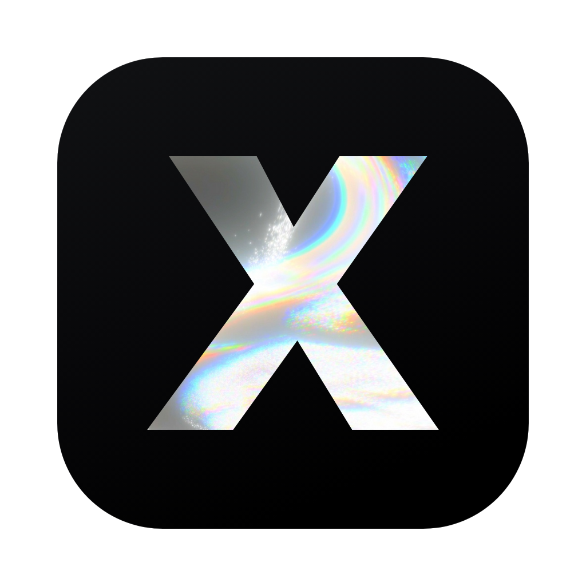
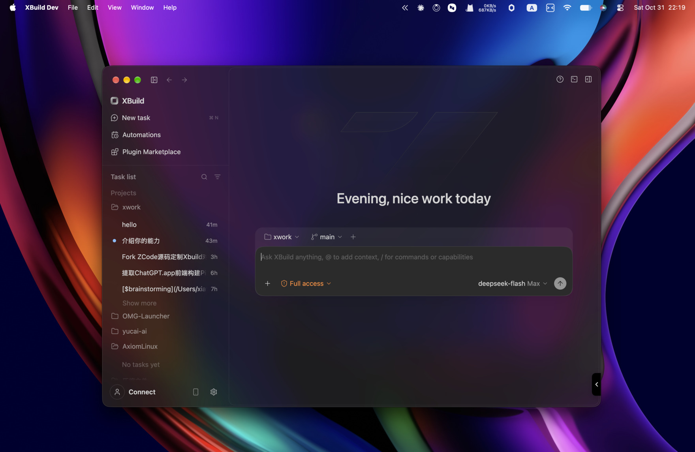
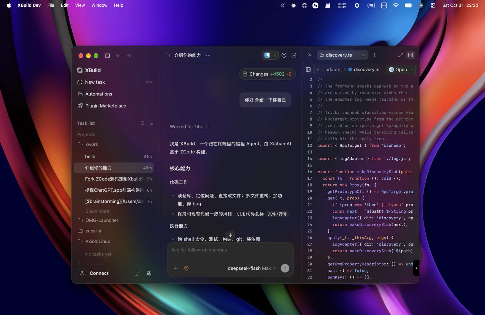

# XBuild

<div align="center">
  
</div>

<p align="center">
  基于 <a href="https://github.com/zai-org/ZCode">ZCode</a> 深度定制的 AI 编程工作台<br />
  全链路接入 <a href="https://nowint.qzz.io">Xiatian AI 中转站</a> · 数据独立于官方 ZCode
</p>

<p align="center">
  <a href="https://nowint.qzz.io">中转站</a> ·
  <a href="https://nowint.qzz.io/console/token">API Key 控制台</a> ·
  QQ 群 <b>1077924207</b>
</p>

<p align="center">
  <a href="https://github.com/NoWint/XBuild/actions/workflows/ci.yml"></a>
  <a href="https://github.com/NoWint/XBuild/actions/workflows/build-desktop.yml"></a>
</p>

---

## 界面预览

<p align="center">
  
</p>
<p align="center"><sub>首页：项目 / 任务列表、全透明毛玻璃侧栏与 Agent 输入框</sub></p>

<p align="center">
  
</p>
<p align="center"><sub>任务页：Agent 对话、Changes 统计与右侧代码审阅</sub></p>

## XBuild 是什么

XBuild 是 [ZCode](https://github.com/zai-org/ZCode) 的深度定制版本，保留其桌面应用、
浏览器界面与终端 Agent 的完整能力，同时做了三件事：

1. **所有 z.ai / bigmodel API 流量改接到 [Xiatian AI 中转站](https://nowint.qzz.io)**（new-api），
   不再直连官方服务，也不需要 z.ai 账号；
2. **数据完全隔离**：用户级数据落在 `~/.xbuild`，与本机已安装的官方 ZCode（`~/.zcode`）互不影响；
3. **品牌与交互重做**：XBuild 名称与图标、透明毛玻璃界面、API Key 优先的登录流程，
   以及可自定义提示词 / 循环钩子 / 侧栏面板的「自定义中心」。

> XBuild 是个人维护的非官方衍生版本，与 zai-org 无隶属关系。上游代码版权归 ZCode 项目所有。

## 致谢 ZCode

XBuild 的每一行基础能力都来自 [ZCode](https://github.com/zai-org/ZCode)：桌面端、Web 端、
终端 Agent、运行时、UI 组件库与工程体系。**特别感谢 zai-org 团队将 ZCode 以
Apache-2.0 协议开源**，让深度定制成为可能。

- 上游仓库：https://github.com/zai-org/ZCode
- 上游英文文档：[README.en.md](README.en.md)（ZCode 原始说明，未被改写）
- 本仓库基于上游 `v3.17.1`（commit `a60ba6a7`）继续开发

如果你更喜欢官方版本、需要 z.ai 账号体系与 coding plan 订阅，请直接使用上游 ZCode。

## 核心特性

### 1. 模型流量全部走 Xiatian AI 中转站

| 类别 | 原上游地址 | XBuild |
| --- | --- | --- |
| Anthropic 格式 | `api.z.ai` / `open.bigmodel.cn` | `https://nowint.qzz.io`（`/v1/messages`） |
| OpenAI 格式 | `api.z.ai/api/paas/v4` 等 | `https://nowint.qzz.io/v1`（`/v1/chat/completions`） |
| ZCode 云服务 | `zcode.z.ai` | `https://nowint.qzz.io`（相关云功能自然停用） |
| OAuth / 商业 API | `chat.z.ai`、`bigmodel.cn` | `https://nowint.qzz.io` |

- 统一收口点：`packages/shared/src/zcodeEndpoint.ts`
- 内置 Provider 目录：`config/provider/zcode-builtin.json`（模板名 **Xiatian AI** /
  **Xiatian AI（OpenAI 格式）**）
- 实测可用模型：`z-ai/glm-5.3-flash`、`z-ai/glm-5.3`（以中转站实际供应为准）
- 官方文档链接与插件市场 CDN（`docs.z.ai`、`cdn-zcode.z.ai`）刻意保留，与模型调用无关

### 2. 数据隔离 `~/.xbuild`

v2 配置、`provider_config.json`、CLI 配置、会话库、日志、遥测、server agents 全部落在
`~/.xbuild`，与官方 ZCode 的 `~/.zcode` 完全分开。

刻意共享：项目级 `<project>/.zcode/`、用户技能库 `~/.zcode/skills` 与 `~/.agents/skills`。

### 3. 界面与品牌

- 四套主题主表面全透明，直通 macOS vibrancy 毛玻璃；浮层半透明 + `backdrop-filter`
- XBuild 圆形环 mark：登录页、关于页、启动页、Dock 图标（icns 全尺寸）、Windows 标题栏、Web favicon
- 登录页移除 OAuth 渠道列表，默认直接粘贴 API Key
- Agent 身份提示词改为 XBuild / Xiatian AI，全部子代理与工具描述同步

### 4. 自定义中心

设置页「自定义中心」（Agent 能力分组），配置写在：

- 全局：`~/.xbuild/custom/overrides.json`
- 工作区：`<workspace>/.zcode/custom/overrides.json`（优先级更高）

支持：提示词分段启用/替换与追加、`beforeModel` / `turnEnd` / `compact` 循环钩子
（inject 或 run 命令）、环境变量补缺、侧栏面板开关排序、`maxTurns` 等运行限制。
overrides 非法时自动回退默认并显示警告，可一键恢复。

## 快速开始

环境要求：Git、Node.js **24.14.0**、pnpm **10.33.2**（以 [mise.toml](mise.toml) 为准）。

```bash
pnpm bootstrap        # 安装依赖 + 准备运行资源
pnpm build            # 全量构建
pnpm build:zcode      # 仅构建 CLI
pnpm dev:desktop      # 启动桌面端开发模式
```

首次启动：

1. 在 Provider 设置中选择 **Xiatian AI**（Anthropic 格式主通道）；
2. 打开 [nowint.qzz.io/console/token](https://nowint.qzz.io/console/token) 创建令牌，复制 `sk-…`；
3. 粘贴到 XBuild 登录页即可开始使用。

> 在官方 ZCode 环境里启动开发实例时，启动脚本会清空继承的 `ZCODE_*` / `ZAI_*`
> 变量，避免读到官方缓存与配置。

## 持续集成与发布

| Workflow | 触发 | 内容 |
| --- | --- | --- |
| [CI](.github/workflows/ci.yml) | push / PR 到 `main` | 图标资产回归、oxlint、全仓 typecheck、桌面端生产构建 |
| [Build desktop installers](.github/workflows/build-desktop.yml) | 手动触发 / 推送 `v*` tag | 构建 macOS arm64+x64 与 Windows x64 安装包 |

推送 tag 即发布：

```bash
git tag v3.18.0 && git push origin v3.18.0
```

工作流会把 `.dmg` / `.zip` / `.exe` 自动附加到对应的 GitHub Release；手动触发时产物
留在 Actions artifacts（保留 14 天）。未配置签名证书时走 ad-hoc 签名，首次打开需右键
→「打开」。

`scripts/verify-app-icons.mjs` 是图标门禁：所有尺寸的四角必须 `alpha = 0`，且圆角外不能
残留偏白的半透明像素（Dock 里那圈白角的来源）。CI 每次都会跑。

## 中转站与社区

- **Xiatian AI 中转站**：https://nowint.qzz.io
- **API Key 控制台**：https://nowint.qzz.io/console/token
- **QQ 群**：1077924207（使用问题、版本反馈、中转站公告）

## 已知限制

以下功能依赖官方 z.ai / bigmodel 服务，在中转站模式下预期不可用：

- z.ai 账号登录（OAuth 全链路）
- coding plan 订阅、升级、余额与用量配额展示
- 内置 `web_reader` MCP
- Web Remote / 手机远控中继
- 官方内置 Provider 配置热更新（本仓库内嵌的 `config/provider/zcode-builtin.json`
  是唯一事实源）

## 详细改动记录

逐轮改动（API 改写清单、数据路径、品牌、毛玻璃、自定义内核）见
[README-XBUILD.md](README-XBUILD.md)。

## 许可证

本项目沿用上游 [Apache License 2.0](LICENSE)，保留 ZCode 的版权与许可声明。
再次感谢 [zai-org/ZCode](https://github.com/zai-org/ZCode) 及所有上游贡献者。

---

<p align="center">
  Made with ❤️ by Xiatian AI · Powered by <a href="https://github.com/zai-org/ZCode">ZCode</a>
</p>
