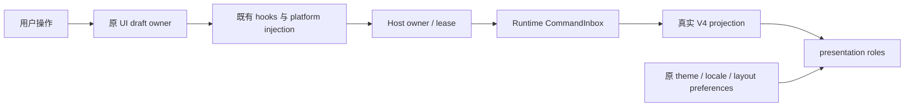

# XBuild Desktop Design System 使用说明

日期：2026-11-15。读者：实现及验收 XBuild UI 的开发者。本文说明可复用角色与所有权，不维护第二套数值主题，也不宣称官方像素复现已通过。

## 文件职责

| 文件                                                                                            | 职责                                             | 禁止承担                            |
| ----------------------------------------------------------------------------------------------- | ------------------------------------------------ | ----------------------------------- |
| [DESIGN.md](../../../DESIGN.md)                                                                 | 仓库设计规则、角色意图、平台与无障碍要求         | 第二份可变 theme values             |
| [styles.css](../../../packages/ui/src/styles.css)                                               | 唯一颜色、几何、字体 role、shadow 和 motion 数值 | Runtime、draft、queue 或 pane truth |
| [desktop-design-system.css](../../../packages/ui/src/desktop-design-system.css)                 | `.xb-*` 呈现角色及共享 primitive 状态            | 新增业务 owner、按 test ID 样式化   |
| [设计与集成规格](../../superpowers/specs/2026-11-14-claude-desktop-ui-reconstruction-design.md) | 产品规则、接口、事件顺序与验收                   | 用静态参考替代运行验收              |
| [reference-measurements.json](reference-measurements.json)                                      | 官方客户端历史静态参考与 provenance              | 应用可变设置、运行态激活证明        |
| [research.md](research.md)                                                                      | 公开规则、来源、差异与参考采集限制               | 功能或像素完成认证                  |

新增或修改行为先维护 spec 和 E2E。共享角色已存在时直接复用，不新增平行 UI、theme store、API 或 runtime framework。所有 role 的当前数值从 `styles.css` 读取；本文只列名字和用途。

## 表面层级

窗口根面、Sidebar、conversation / terminal / Side Pane frame、内容 card、menu / popover / dialog 是不同层级。用 semantic surface 和边界表达层级，不把全部内容装成聊天气泡，也不把普通 page section做成浮动卡。

| 角色                 | 推荐 semantic tokens                                                 | 使用规则                                             |
| -------------------- | -------------------------------------------------------------------- | ---------------------------------------------------- |
| 窗口根面             | `background-alt` / `background-win-alt`                              | 原平台决定透明或不透明；CSS 不伪造 native material   |
| Sidebar              | `sidebar`                                                            | navigation、分区、task/project 列表；不要当通用 card |
| 普通 workspace frame | `background`、`border`                                               | 独立 conversation / terminal / Side Pane，内容可收缩 |
| 普通内容块           | `surface`                                                            | 低强调内容；selected 另用 `selected`                 |
| 文件 / 产物 card     | `card`、`card-border`                                                | 有真实标题、类型、状态与动作的重复条目               |
| Menu / select panel  | `menu`、`menu-hover`、`popover-border`                               | 紧凑选项，不做多层子卡                               |
| Popover / dialog     | `popover`、`popover-border`                                          | 保留 overlay shadow 与焦点合同                       |
| 主编辑器             | `input`、`input-border*`                                             | hover / focus-within / disabled；不使用默认炫光      |
| 状态                 | 现有 success / warning / destructive / progress / interaction tokens | 必须来自真实状态，并配文字；不为装饰借用语义色       |

主文本用 `foreground`，辅助文本用 `foreground-subtle`，弱 metadata 用 `foreground-subtlest`。字号与前景层级是独立选择。Git、Diff、文件类型、远端连接类别和等待确认保留各自 token，不用中性色重写状态语义。

Light / Dark 继续使用现有主题 ID 与 Zai preference 兼容。semantic tokens 在两个主题共用，颜色值只由 `styles.css` 决定。主题切换沿原 store / broadcast 路径，防止回环，不根据 class 另存一份 theme truth。

## 几何与排版角色

| Role / token family                                                              | 用途                                | 使用边界                                                |
| -------------------------------------------------------------------------------- | ----------------------------------- | ------------------------------------------------------- |
| `--desktop-sidebar-width`                                                        | 新默认 Sidebar 比例                 | 已保存的用户宽度优先；不写回覆盖                        |
| `--desktop-header-height` / `h-desktop-header`                                   | structural header                   | 不用 label 或 loading 内容撑高                          |
| `--desktop-reading-width` / `max-w-desktop-reading`                              | conversation 与 composer 共用 rail  | 允许 flex shrink；不是用户 wide/full 设置               |
| `--desktop-reading-gutter*`                                                      | reading rail 边距                   | breakpoint 调布局，不按 viewport 缩放字号               |
| `--desktop-sidebar-row-height` / `min-h-desktop-sidebar-row`                     | 桌面单行 compact row                | 多行状态、workflow 和远端信息允许撑高，不能剪裁         |
| `--desktop-touch-row-height`                                                     | 窄屏主要触控行                      | 不把 desktop 密度作为 touch hit target                  |
| `--desktop-frame-radius`                                                         | 明确 framed card / artifact         | 不替代原生窗口壳或普通 page section                     |
| `--desktop-composer-radius*`                                                     | 主 Lexical composer 与 drag overlay | normal / comfortable role，不推导虚构设置入口           |
| `--desktop-control-radius` / `--desktop-menu-radius` / `--desktop-dialog-radius` | 控件和独立 overlay                  | 共享 primitives 决定，不从 trigger DOM 层级推导 overlay |
| `--desktop-shadow-composer` / `--desktop-shadow-popover`                         | 编辑器与浮层层级                    | 不添加页面级重阴影；focus 不清空 overlay shadow         |

`--desktop-reading-width-wide` 的声明不构成公开产品偏好。当前聊天使用合同指定的 shared rail；源码没有 conversation wide/full 配置，不添加第二条设置写入路径。

### Typography

| Utility                                                   | 内容角色                                                    |
| --------------------------------------------------------- | ----------------------------------------------------------- |
| `font-sans`                                               | 普通 interface 与 assistant reading；使用合法系统 fallback  |
| `font-voice`                                              | 真正的 new-draft greeting / XBuild wordmark；不复制官方字体 |
| `font-mono`                                               | 代码、路径、命令、hash、model ID 与 terminal 数据           |
| `text-ui-base`                                            | 普通控件、正文标签与较强标题                                |
| `text-ui-caption`                                         | compact project/task 主标题、thinking/tool summary          |
| `text-ui-sm`                                              | Sidebar 分区、说明、tooltip、Markdown inline code           |
| `text-ui-xs`                                              | badges、计数、上传百分比、弱 metadata                       |
| `text-ui-lg` / `text-ui-xl`                               | 阅读标题；不要扩大 compact 面板标题                         |
| `text-ui-prose`                                           | assistant Markdown 正文；非控件字号                         |
| `text-ui-welcome` / `text-ui-welcome-compact`             | 真实 draft greeting 及紧凑布局变体                          |
| `text-ui-settings-title` / `lg:text-ui-settings-title-lg` | 共享 Settings 大标题专用                                    |
| `text-mobile-input-safe`                                  | 需要防 iOS focus zoom 的手机 Web editable input             |

所有普通 UI 使用 `text-ui-*`。不要引入 Tailwind `text-sm` / `text-base` / `text-xs`、任意 inline font-size 或 viewport 字号公式。字母间距为 0。interface font preference 只改变 `--ui-font-size`，不修改 `html` 字号，不连带放大 icons、spacing、radius。

Markdown 正文使用 prose role；标题、列表、表格、行内代码和工具按钮继续采用对应既有角色。代码、Diff、terminal 内容沿独立字号及 wrap 设置，外部 header / controls 仍是 interface role。不要全局把 Streamdown 所有后代都强制变成 prose。

`text-ui-2xs` 仅保留原 workflow graph axis furniture 例外，不能用于上传数字、文件状态、操作或普通 metadata。

## 可复用 `.xb-*`

这些 class 只描述呈现。组件状态、handler 与 dependency injection 继续由原模块提供。`data-slot` 是共享 primitive 合同，`data-testid` 不是样式选择器。

| Class                       | 位置 / 含义                                                  | 保留的行为所有者                            |
| --------------------------- | ------------------------------------------------------------ | ------------------------------------------- |
| `.xb-desktop-frame`         | `DesktopWindowFrame` / workspace 根层，interface font 和前景 | platform window / 原 shell                  |
| `.xb-workspace-header`      | workspace / Side Pane structural header                      | 原 header actions / pane state              |
| `.xb-conversation-frame`    | conversation 独立结构面                                      | 原 shell 与 timeline                        |
| `.xb-side-pane-frame`       | Side Pane 独立结构面                                         | 原 pane preference、tabs、guest             |
| `.xb-terminal-frame`        | terminal 独立结构面                                          | 原 terminal service / instance              |
| `.xb-reading-rail`          | chat、draft 与 composer 共用宽度约束                         | 原 layout preference；role 不保存尺寸       |
| `.xb-draft-reading-rail`    | 真实 draft 的 rail 标记                                      | 不是独立状态 store；不代表另一个聊天页面    |
| `.xb-sidebar-navigation`    | 主导航密度与按钮基线                                         | `ProjectSidebarNavigation` 原 actions       |
| `.xb-sidebar-wordmark`      | XBuild 产品名与合法 voice role                               | 不冒用官方名称或资产                        |
| `.xb-sidebar-row`           | project / task / search compact row                          | 原索引、过滤、排序、复合 identity           |
| `.xb-sidebar-list-header`   | 分区辅助文本                                                 | 原列表/分组操作                             |
| `.xb-profile-trigger`       | 左下账户 / settings menu 触发器                              | `WorkspaceSidebarFooter` 真实 account       |
| `.xb-greeting`              | 欢迎文本的 voice、wrap 与缩短                                | 原 draft greeting / i18n                    |
| `.xb-composer-shell`        | 主编辑器外壳、边框、focus-within                             | Lexical、draft、upload gate                 |
| `.xb-composer-drag-overlay` | 与 composer 同形的 drag 提示层                               | 原 drop/paste pipeline                      |
| `.xb-composer-toolbar`      | 真实工具栏标记与布局组合                                     | 原 model/provider/effort/context handlers   |
| `.xb-artifact-card`         | 文件产物的稳定 frame、类型图标、标题与状态                   | 原文件校验、stat、真实 preview source       |
| `.xb-open-split`            | 主 open action 与 menu reveal 的紧凑分段控件                 | 原 open / download / menu handlers          |
| `.xb-preview-header`        | 文件 reader 的 structural header                             | 原 file routing、reader 与 toolbar actions  |
| `.xb-animated-pane`         | Side Pane / terminal 的有限 opacity 呈现与 reduced motion    | 原 pane release、resize admission、实例保活 |
| `.xb-user-bubble`           | 用户消息容器与 semantic surface                              | V4 原 accepted message projection           |
| `.xb-assistant-content`     | assistant prose、换行与字体                                  | 原 Markdown / Streamdown 解析与缓存         |
| `.xb-thinking-trigger`      | 弱化可展开 thinking summary                                  | 真实 runtime thinking / 原 collapse         |
| `.xb-tool-summary`          | compact tool summary / 状态标题                              | 真实 tool rows / 原 renderers               |
| `.xb-settings-panel`        | Settings 内容主面                                            | 原注册配置分类 / settings scope             |
| `.xb-settings-nav`          | Settings navigation 面                                       | 原导航、返回、search                        |

布局标记不是全部都有独立 CSS rule。以当前 `desktop-design-system.css` 的定义为准，复用工具类组合，不把一个源码 class 的存在误报成新功能。文件产物 card 使用 `--desktop-frame-radius`，文件 header 使用 `--desktop-header-height`；数值不放在 reader 或业务状态层。

assistant response 自身采用 `text-ui-prose` 的字号与行高，不再在 renderer 默认项中另存一套正文比例。`.xb-assistant-content` 是外部阅读角色；标题、code、table 仍由原组件和各自 roles 控制。文件与 pane role 的加入不改变 parse、cache、stat、native/remote routing 或完成顺序。

### 组合示例

以下是角色组合，不是替换组件。继续将原 handlers、props 和 hooks 传给现有组件。

```tsx
<div className="xb-reading-rail min-w-0">
  <div className="xb-assistant-content text-ui-prose">
    {existingMarkdownRenderer}
  </div>
</div>

<div className="xb-composer-shell min-w-0 border">
  {existingLexicalEditor}
  {existingComposerToolbar}
</div>

<div className="xb-sidebar-row flex min-w-0 items-center">
  {existingTaskRowContent}
</div>
```

不要用这类 wrapper 创建假消息、假 Thinking 或 mock file path。代码示例的占位变量代表已有组件引用，不能作为 product data source。

## 控件与浮层状态

Button、Input、Textarea、Select、Dropdown、ContextMenu、Popover、Dialog、AlertDialog 和 Tooltip 使用既有共享 primitives。保留 size / variant、Radix keyboard navigation、焦点陷阱、Esc、屏幕边缘约束和触发器焦点返回。

| 状态               | 呈现规则                                           | 交互边界                                  |
| ------------------ | -------------------------------------------------- | ----------------------------------------- |
| default            | 定义稳定尺寸、semantic surface、可读 label         | 不因 label 或状态变化移动布局             |
| hover              | menu-hover / input-border-hover 等既有 token       | hover 不是唯一发现动作方式                |
| focus-visible      | 原 primitive border / ring；forced-colors 可见     | 不新增全局 `!important` outline           |
| focus-within       | composer 外层边界强调                              | 组合输入不要叠第二圈内框                  |
| selected / checked | check / radio / trailing marker 与 selected role   | 保留真实选择，不伪造不可用模型            |
| disabled           | 原 aria / disabled 与弱化前景                      | 不改变 hit target，不隐藏原因或原能力     |
| loading            | 原 spinner / progress 与文字                       | 只渲染真实上传、连接或运行态              |
| error              | semantic error、原 retry / dismiss                 | 不以固定超时掩盖同步或 permission 问题    |
| open overlay       | 从 first frame 保持 shadow、border 和 overlay 层级 | Tooltip 不遮挡交互 menu；Esc 后回原触发器 |

相邻选项间距由共享 option stack 管理。不同菜单复用同一 action list 时保留顺序与动作，不各建一套业务命令。split action 使用主按钮与 reveal 分段，不让 chevron 点击意外执行主操作。

附件 close、retry、context remove 在 hover、keyboard focus、touch 都可发现。上传百分比使用 `text-ui-xs`；预览/移除动作不能绕过 ready gate、accepted/adopt 事务或原 upload owner。

## Motion

| Token                       | 角色                                         |
| --------------------------- | -------------------------------------------- |
| `--desktop-duration-fast`   | row hover、tooltip 等即时视觉反馈            |
| `--desktop-duration-snap`   | 普通 controls、composer border、menu/popover |
| `--desktop-duration-base`   | 已有一般呈现 transition                      |
| `--desktop-duration-layout` | header、Side Pane / terminal 等布局呈现      |
| `--desktop-ease-out`        | 共享有限 transition 曲线                     |

优先采用淡入、边界与有限位置变化，不加默认弹簧、光晕或装饰性无限运动。motion 只展示状态，不计算 queue、run completion、owner/lease 或 pane release 时刻。

`prefers-reduced-motion` 时关闭非必要动画，保持原状态更新、focus 和交互。Side Pane / terminal opacity 接共享角色时，不移动 resize admission、实例保活或收起完成边界。

## 响应式与平台

- 使用 `min-w-0` / `min-h-0` 保证阅读、输入、列表和嵌套 scroll 可以收缩。宽度不够时改变 rail、布局或 drawer，不按窗口宽度缩字号。
- Sidebar 单行 compact role 不适用于手机主要 hit target。多行状态自然撑高；长名称可以截断，但核心动作和状态不能被裁掉。
- 主题、语言、UI font、代码 font、长内容与 reduced motion 都要组合验证。按钮/heading 的文本不能越界或覆盖后续内容。
- macOS / Windows native material 由 `IPlatformService` 与原窗口 owner 处理；Web / Linux 原有不透明根面和窗控边界保留。macOS 证据不能替代其他平台实机证据。
- split、Side Pane full view、terminal 与自定义宽度沿原 owner。只改变默认呈现比例，不清理用户已有 preference。
- 手机仍使用已有 attachment / replayable 恢复和 drawer，不创建第二个 Runtime、Agent 或 Local Host。

## 状态与事件所有权



`presentation roles` 不反向写入 accepted queue 或 runtime status。model/provider 选择沿原 typed config action；文件 open/save/download 沿现有 hooks / `IPlatformService`；project/task 搜索沿原 service/index。

保留 `workspaceIdentity?.trim() || workspacePath`、`remoteSessionId`、owner/lease 和 stale run 校验。DSH、MCP、provider、权限、workflow、background、plugins、文件和 panes 的能力注册不因视觉参考而删减。

## 维护与验收

1. 修改规则先维护对应 spec。交互先维护真实入口 E2E；纯视觉 role 也必须有可重复几何、主题与状态断言。
2. 从 `styles.css` 读取 computed values，不把研究 JSON 当另一份产品 theme。调整新 role 时同步本说明的意图，避免数字漂移。
3. 分开报告组件、全应用、真实 runtime、远端和跨平台执行。单个 fixture 或 visible entry 通过不能提升其他状态。
4. 全任务必须执行仓库 typecheck、lint、architecture 和目标格式/构建/验收。命令与真实结果由 [build-validation.md](build-validation.md) 集中维护。
5. 官方同状态截图仍受权限、认证和 rollout 限制。比较需要 metadata、Overlay / Difference 与原图；缺图时不得给相似率。

当前源码与执行状态见 [coverage.md](coverage.md)。本说明是一份复用合同，不是整套应用完成清单。
