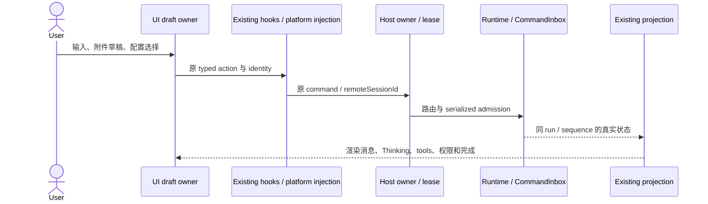

# Claude Desktop 实证研究

研究日期：2026-11-15。静态测量日期：2026-11-14。范围：桌面信息架构、布局、控件、主题及交互状态。本文不是像素一致性认证，也不是 Claude 产品能力的实现承诺。

## 结论

XBuild 应复用现有应用，重建共享 presentation roles。不要另做单页聊天演示，也不要嵌入官方客户端。窗口、Sidebar、会话列表、Composer、Thinking、工具、文件、Settings 和账户入口都必须接回原组件与真实状态。

本机 `/Applications/Claude.app/Contents/Info.plist` 的 `CFBundleShortVersionString` 在本轮只读重查仍为 **5.11492.5**。这只确认安装版本，不确认它是最新版本，也不确认账户已进入哪一条 rollout。静态样式同时包含 native CDS、Web 与 Fizzy Lake 分支，不能把各分支拼成一个已观察界面。

当前没有合法采集的、同尺寸同主题同状态的官方参考截图。历史隔离启动成功，但系统没有窗口截图权限，官方应用拒绝调试和 network-override 开关，登录后页面未观察。没有绕过这些限制。本轮没有启动、修改或调试 Claude，没有访问任何个人 profile、凭据、聊天或用户数据。

因此可以报告静态测量、公开交互规则、XBuild 源码映射与验证缺口，不能报告 1:1 通过、像素一致率或虚构 Overlay / Difference。执行结果由 [coverage.md](coverage.md) 和 [build-validation.md](build-validation.md) 记录，不能由本研究的源码检查代替。

## 证据分级

| 标签                         | 含义                                    | 可以证明                                 | 不可以证明                                   |
| ---------------------------- | --------------------------------------- | ---------------------------------------- | -------------------------------------------- |
| S：installed static evidence | 已安装客户端的历史静态测量，记录在 JSON | 某版分发客户端存在这些数值或分支         | 分支已激活、控件可达、所有值同时生效         |
| P：official public docs      | 本轮实际读取的官方帮助中心文章          | 官方公开描述的规则、入口、可用条件       | 本机版本的像素、账户 rollout、当前运行态     |
| O：actual runtime observed   | 合法实例的运行态记录                    | 历史隔离初始窗口启动成功；记录见 JSON    | 未登录页面、工具过程、动态菜单或完整双主题   |
| I：XBuild implementation     | 当前检出源码和已接入的 roles            | 原组件与动作路径存在；当前呈现有对应入口 | 已执行 E2E、真实 runtime 正常、对比已通过    |
| B：reference capture blocked | 参考运行态没有可用采集条件              | 哪些比较仍不能执行及原因                 | 以第三方图、静态 CSS 或 fixture 自动补齐证据 |

本文中的“已读”指实际取得 HTTP 200 的公开文本，并用现有 `cheerio` 解析页面结构。没有下载大型媒体，没有运行第三方代码，没有新建依赖。页面中的图片链接存在不等于已检查图片；本研究不把未检查图片当视觉依据。

## 来源与可追溯性

### 本地来源

| ID  | 来源                                                                                            | 本轮使用方式                                                   |
| --- | ----------------------------------------------------------------------------------------------- | -------------------------------------------------------------- |
| S1  | [reference-measurements.json](reference-measurements.json)                                      | 读取完整历史测量和采集限制，不重新提取闭源实现                 |
| S2  | `/Applications/Claude.app/Contents/Info.plist`                                                  | `plutil -extract CFBundleShortVersionString raw ...`，只读版本 |
| X1  | [设计与集成规格](../../superpowers/specs/2026-11-14-claude-desktop-ui-reconstruction-design.md) | 产品规则、所有者、接口及 CDR 验收场景                          |
| X2  | [DESIGN.md](../../../DESIGN.md)                                                                 | 仓库设计规范、专用 typography roles、平台和无障碍约束          |
| X3  | [styles.css](../../../packages/ui/src/styles.css)                                               | 唯一可变主题、几何与 motion 数值来源                           |
| X4  | [desktop-design-system.css](../../../packages/ui/src/desktop-design-system.css)                 | 可复用 `.xb-*` 与 primitives 状态角色                          |

工作区新鲜度检查在本轮通过。当前分支没有远端 tracking，脚本已明确跳过该项；不能将其解释为已检查所有远端状态。

### 官方公开来源

以下页面均在 2026-11-15 实际读取，HTTP 200。链接从帮助中心首页、集合页或已读文章中发现；文章的最终重定向地址保留在表中。公开文章会持续更新，不能把访问日期或文章相对更新时间当作本机版本发布日期。

| ID  | 官方 URL                                                                                                                                           | 本轮提取的事实                                                                                         |
| --- | -------------------------------------------------------------------------------------------------------------------------------------------------- | ------------------------------------------------------------------------------------------------------ |
| P1  | [Install Claude Desktop](https://support.claude.com/en/articles/10065433-install-claude-desktop)                                                   | macOS、Windows、Linux beta；Chat / Code / Cowork 是不同能力；需要登录；扩展入口兼列新旧 Settings       |
| P2  | [Getting Started with Local MCP Servers](https://support.claude.com/en/articles/10949351-getting-started-with-local-mcp-servers-on-claude-desktop) | Extensions 安装与配置、连接状态；Composer `+` → Connectors；管理员与权限条件                           |
| P3  | [Release notes](https://support.claude.com/en/articles/12138966-release-notes)                                                                     | 发布记录描述产品迁移和逐步 rollout；不是某个本地窗口的视觉证据                                         |
| P4  | [Claude Cowork and chat are one Claude](https://support.claude.com/en/articles/16761823-claude-cowork-and-chat-are-one-claude)                     | unified experience 分批开放；Recents 合并；模型入口和 Code tab 保留；新旧账户可以不同                  |
| P5  | [Get started with Claude Cowork](https://support.claude.com/en/articles/13345190-get-started-with-claude-cowork)                                   | 多步骤任务、进度、权限、产物及本地访问条件；新旧模式和云端运行语义                                     |
| P6  | [Organize your tasks with projects](https://support.claude.com/en/articles/14116274-organize-your-tasks-with-projects-in-claude-cowork)            | 左侧 Projects、创建方式、文件和 instructions、archive 及本地项目迁移差异                               |
| P7  | [What are artifacts and how do I use them?](https://support.claude.com/en/articles/17153992-what-are-artifacts-and-how-do-i-use-them)              | 产物在会话旁打开；编辑、回访、分享、导出；legacy artifacts 与新模板规则不同                            |
| P8  | [Use live artifacts in Claude Cowork](https://support.claude.com/en/articles/14729249-use-live-artifacts-in-claude-cowork)                         | 旧 live artifacts 的识别、重新发布与组织分享边界                                                       |
| P9  | [Change the model, effort, and thinking settings](https://support.claude.com/en/articles/8664678-change-the-model-effort-and-thinking-settings)    | send 旁模型菜单、More models、effort、thinking；更改用于下一次响应；部分模型不显示关闭 thinking 的选项 |
| P10 | [Customizing your appearance settings](https://support.claude.com/en/articles/8887527-customizing-your-appearance-settings)                        | 左下账户 → Settings；Light / Match System / Dark；Chat font；Sidebar 可以收起但不能完全禁用            |
| P11 | [Upload files to Claude](https://support.claude.com/en/articles/8241126-upload-files-to-claude)                                                    | `+` → Add files or photos、拖放、图片粘贴、会话与 project 文件入口、上传失败条件                       |
| P12 | [Delete or rename a conversation](https://support.claude.com/en/articles/8230524-delete-or-rename-a-conversation)                                  | Web Sidebar hover 菜单、rename/delete 与删除确认；文章分开描述手机方式                                 |
| P13 | [Share and unshare chats](https://support.claude.com/en/articles/10593882-share-and-unshare-chats)                                                 | 顶部 Share、快照、撤销分享、空列表；附件与原始 MCP 数据有独立分享边界                                  |
| P14 | [Chat search and memory](https://support.claude.com/en/articles/11817273-use-claude-s-chat-search-and-memory-to-build-on-previous-context)         | 搜索历史可以呈现 tool call；project 边界、隐私条件；不是 Sidebar 过滤的同义词                          |
| P15 | [Log in to your Claude account](https://support.claude.com/en/articles/13189465-log-in-to-your-claude-account)                                     | Google / email 登录、左下账户切换与勾选标识；第三方软件不应冒充官方应用或复用订阅流量                  |

### 公开开源项目

本轮 GitHub public API 返回 403 rate limit，未添加 token、未认证重试。随后读取公开仓库页面的 README 和公开许可证文件，HTTP 200。下表描述已读说明，不声称已分析其 executable source。

| 项目                                 | 已读来源                                                                                                                                                                                                                                                         | 结论与限制                                                                                                                                                                                                                        |
| ------------------------------------ | ---------------------------------------------------------------------------------------------------------------------------------------------------------------------------------------------------------------------------------------------------------------- | --------------------------------------------------------------------------------------------------------------------------------------------------------------------------------------------------------------------------------- |
| `truthprotectors/Claude-clone-UI-UX` | [仓库与 README](https://github.com/truthprotectors/Claude-clone-UI-UX)、[MIT](https://raw.githubusercontent.com/truthprotectors/Claude-clone-UI-UX/main/LICENSE)                                                                                                 | 独立 Claude-style chat UI。README 声明单 HTML、Python demo、脚本流式回答、session sidebar、thinking、tools、diff、model、permission、attachments、mobile 和 themes。未读取或运行 `index.html`、`demo_server.py`，未采用其图或代码 |
| `aaddrick/claude-desktop-debian`     | [仓库与 README](https://github.com/aaddrick/claude-desktop-debian)、[MIT](https://raw.githubusercontent.com/aaddrick/claude-desktop-debian/main/LICENSE-MIT)、[Apache 2.0](https://raw.githubusercontent.com/aaddrick/claude-desktop-debian/main/LICENSE-APACHE) | 当前 README 描述官方 Linux `.deb` 的非官方格式重打包，不是从零实现的 UI 组件库。脚本许可证不覆盖官方 Claude 应用；未下载安装包、未运行 launcher/patch、未使用其截图证明 macOS 当前外观                                            |

MIT 或 Apache 不会自动赋予官方商标、专有字体和客户端资源的复制权。这里只参考公开的布局及交互描述。XBuild 保留自身产品名、现有图标和操作系统合法字体，不复制品牌图标、bundled Anthropic Sans / Serif 或闭源代码。

## 版本与 rollout

公开来源明确存在过渡期：

- P4 描述 Chat / Cowork 合并后的单一会话入口，同时说明同计划账户仍可能看到旧模式。不能只按安装版本猜测是否已合并。
- P1 / P2 / P10 兼列 `Settings > Desktop app / Appearance` 与旧 `Settings > Extensions / General`。入口命名需要按参考账户实际画面确认。
- P1 仍描述本地 VM；P4 / P5 描述新的云端会话以及需要 Desktop 保持打开的本地文件与应用访问。记录为不同阶段的公开说明，不反推本机 task owner。
- P7 / P8 区分新的 artifacts、legacy artifacts、早期 live artifacts。不能用一张旧代码面板图代表全部产物表面。
- P12 的 Web 菜单规则和手机长按规则不等于 native Desktop 已实测；P14 的模型历史搜索与 Sidebar 查询也必须分别验证。

研究采用 native CDS 的中性桌面密度作为 XBuild presentation 方向，完整限制见 X1。选择设计方向属于 XBuild 的决策，不是宣称 native CDS 是本机已激活分支。

## 静态数值索引

数值的 provenance 和完整集合只在 S1。以下索引用于回溯参考，不是第二套可变主题。产品值以 X3 为准，不能从本表向组件写入 inline 数值。

| 观察对象         | S1 JSON 字段                                                                      | 参考含义                                                                       |
| ---------------- | --------------------------------------------------------------------------------- | ------------------------------------------------------------------------------ |
| 原生 Sidebar     | `nativeFrame.sidebarWidthPx`、`sidebarInsetPx`                                    | 静态宽度 288px、inset 8px；未证明当前窗口激活                                  |
| 原生 chrome      | `nativeFrame.chromeHeightPx`、`contentGutterPx`                                   | 静态 chrome 36px、内容 gutter 8px                                              |
| 原生紧凑行       | `nativeFrame.rowHeightPx`、`rowControlPx`、`rowFontPx`、`groupFontPx`             | 行 26px、行控件 20px、主标题 13px、分组 12px；多行状态不能机械剪裁             |
| 原生图标与间距   | `nativeFrame.iconPx`、`rowStackGapPx`、`rowGapPx`                                 | 图标 16px、行堆叠 2px、行内 4px                                                |
| 原生 frame / row | `nativeFrame.cardRadiusPx`、`rowRadiusPx`                                         | 静态卡 frame 8px、行 6px                                                       |
| Web / touch      | `webFrame.*`                                                                      | Web 与原生不是一套密度；touch 行 44px，不能把 26px 原生 hit target直接搬到手机 |
| 阅读             | `cdsFoundation.proseDefaultPx`、`proseDefaultLineHeightPx`                        | 默认正文 15px / 21px，仅静态参考                                               |
| Composer         | `cdsFoundation.composerRadiusPx`、`comfortableComposerRadiusPx`                   | normal / comfortable 分支存在，不证明用户可切换的偏好入口                      |
| Motion           | `cdsFoundation.fastMs`、`snapMs`、`baseMs`；`nativeFrame.layoutSlowMs`、`easeOut` | 分级 transition 线索，不是实测动画时序                                         |
| 双主题           | `cdsFoundation.light/dark`、`fizzyLakeBranch.light/dark`                          | 不同色阶集合共存；Fizzy Lake 的 `activationConfirmed` 为 false                 |
| 字体             | `fontReferences`                                                                  | 字体角色存在；专有字形未复制，字形差异保留为验收限制                           |

XBuild 的 shared reading rail 宽度是 X1 的集成决定。S1 没有对应聊天宽度字段，不能把 XBuild 的 rail 数值写成官方实测。当前源码没有用户可选的 conversation wide/full 偏好；不从一个 CSS token 推导出产品设置。

## 全表面映射与缺口

下表逐项列出 S / P / O / I / B。O 列的“未观察”表示没有对应官方运行态，不表示 XBuild 没有组件。I 是源码存在与角色接入，执行状态必须查 coverage。浅色与深色都适用，不能由一套主题外推另一套。

| 表面               | S：静态证据                    | P：公开规则                             | O：实际官方运行态                   | I：XBuild 当前映射                                                        | B：待补参考与动作                                         |
| ------------------ | ------------------------------ | --------------------------------------- | ----------------------------------- | ------------------------------------------------------------------------- | --------------------------------------------------------- |
| 窗口               | native chrome、gutter、层级    | P1 平台；P10 Sidebar 收起               | 历史 clean 600×600 初始窗口；无截图 | `DesktopWindowFrame`、App、Workspace shell、原生窗控                      | 双主题窗控、拖拽、最大化、平台材质画面                    |
| Sidebar 导航       | 宽度、inset、compact roles     | P4 Recents；P10 开合                    | 登录后未观察                        | `ProjectSidebarNavigation`、`.xb-sidebar-navigation`、XBuild wordmark     | 开合、长标签、tooltip、keyboard focus                     |
| 会话列表           | 行高、图标、row gap            | P4 一列表；P12 菜单                     | 未观察                              | 原 task/index hooks、TaskList / ProjectSidebar 行与菜单                   | hover、selected、未读、置顶、归档、排序与空列表           |
| New Chat           | 无完整静态页面证据             | P4 统一/旧模式；P10 appearance          | 未观察                              | `ConversationDraftEmptyState`、真实 draft、workspace 与插件建议           | greeting、空白、workspace 选择、保留未发送草稿            |
| 主聊天             | prose 与 gutter 线索           | P4 / P5 长任务与进度                    | 未观察                              | `ConversationTimeline`、V4 projection、shared reading rail                | 历史恢复、滚动、流式、完成、长消息与 resize               |
| Composer           | normal / comfortable radius    | P9 send 邻接菜单；P11 `+`               | 未观察                              | `ChatPromptEditor`、Lexical、`ConversationComposer`                       | IME、Enter / Shift+Enter、disabled、busy、stop            |
| Model / effort     | 无已确认菜单几何               | P9 model、More models、effort、thinking | 未观察                              | `ComposerModelMenu`、原 provider/config 选择                              | 可用/不可用、当前选中、submenu、cancel、配置结果          |
| 附件与上下文       | compact / touch 线索           | P2 Connectors；P11 file/drop/paste      | 未观察                              | 原 upload store、`useComposerAttachments`、context chips                  | 上传中、失败、重试、移除、preview、focus 与 touch 发现性  |
| Thinking           | prose / compact 角色线索       | P9 timer、可展开 summary                | 未观察                              | `reasoning.tsx`、真实 runtime thinking projection                         | 运行 timer、折叠、完成、缺失 summary；禁止生成假 thinking |
| Tool Calling       | 无完整过程截图                 | P2 tools；P5 进度/权限；P14 search tool | 未观察                              | `ToolCallBlocks`、`ToolSummaryRow`、既有 renderers                        | 参数/结果、partial、MCP、background、subagent、workflow   |
| 权限交互           | 仅通用状态层级                 | P5 / P4 permission mode 条件            | 未观察                              | 既有 permission / AskUser / mode actions                                  | Allow / Deny、等待、禁用、错误及真实 continuation         |
| Artifacts          | card / panel 静态层级          | P7 / P8 分类、回访、编辑、导出          | 未观察                              | `AssistantPreviewCards`、Side Pane、真实文件与 HTML 等 reader             | 各类型 open、回访、下载、guest 生命周期、错误             |
| 文件预览           | header / frame 线索            | P4 文件在会话旁；P7 导出                | 未观察                              | `PreviewPane`、office/PDF/image/media readers、IPlatformService           | 本地与远端文件、stat、不存在、读取失败、保存              |
| 代码 / Diff        | font mono 角色                 | P7 legacy code/copy/download            | 未观察                              | 原 code preview、独立字号/换行、Diff 与 terminal                          | 长行、copy、wrap、find、实际文件与主题语义色              |
| Markdown           | 正文 15/21 参考                | P5 / P7 文档及局部编辑                  | 未观察                              | 原 `response` / Streamdown、`.xb-assistant-content`、links/citation/table | 标题、列表、表格、代码、图、streaming 与完成解析          |
| Message actions    | 无已确认 action bar 几何       | P7 编辑较早消息；P13 Share              | 未观察                              | 原 copy、edit、fork、retry、share、选择引用                               | hover / keyboard / touch、焦点、失败、回到 draft          |
| Settings           | menu / surface / text 线索     | P2 / P9 / P10 新旧路径                  | 未观察                              | 原 `SettingsPage` 和所有注册分类；shared nav/panel                        | 全分类可达、保存/取消、theme、font、locale、返回          |
| Account            | 通用 popover 线索              | P10 左下入口；P15 登录/切换             | 未观察                              | `WorkspaceSidebarFooter`、真实 account hook、原菜单                       | 未登录/登录、长名称、plan、更新、反馈、退出、Esc          |
| Search             | compact 控件线索               | P4 Recents 搜索限制；P14 历史搜索不同   | 未观察                              | 原 cmdk `CommandCenterDialog`、hooks、file service                        | 查询、scope、history、结果/空白/失败、选择与焦点恢复      |
| Projects           | compact 分组/行                | P6 创建、instructions、archive          | 未观察                              | 原 project/service owner、workspaceIdentity、remoteSessionId              | 创建/导入、远端、删除项目、拖放、分组、local fallback     |
| Loading            | 通用 neutral/state roles       | P5 progress 与 workspace setup          | 未观察                              | 既有真实 loading/progress projection                                      | 首载、恢复、上传、tool partial，不用固定假 timer          |
| Empty              | 通用 reading / controls        | P13 无 shared content；P4 新会话        | 未观察                              | draft、search 与原列表空态                                                | 每类真正空态，不能用营销页替换产品入口                    |
| Error              | 通用 semantic layers           | P2 配置/权限；P11 上传；P7 artifact fix | 未观察                              | 原错误内容、retry、permission 与连接状态                                  | 可恢复/不可恢复、重试结果、错误长度和双主题               |
| Popovers / dialogs | radius、motion 分级            | P2 / P9 / P10 / P13 的菜单流程          | 未观察                              | 原 Radix primitives 与受控 open/focus                                     | first frame shadow、Esc、焦点返回、submenu、屏幕边缘翻转  |
| Resize / split     | 静态 Sidebar 宽度              | 未取得官方精确尺寸/持久化规则           | 未观察                              | 原 shell layout、resize preference、Side Pane、terminal                   | 实际 drag、最小宽度、composer 可见、draft 与 pane 保活    |
| 浅 / 深主题        | native CDS / Fizzy Lake 多分支 | P10 Light / Match System / Dark         | 未观察完整任一主题                  | 既有主题 ID / store / broadcast；X3 共享 semantic mapping                 | 同账户同状态双主题、系统切换、持久化与 reduced motion     |

## 为什么不采用 generic chat clone

公开 clone 的 README 已覆盖多个聊天 affordances，但它的 demo 使用脚本回答，采用另一套 session / event / queue API。它既不是当前官方完整 Desktop，也不是 XBuild 的真实 Agent 系统。其单 HTML、演示数据、控制流和图片不能证明 native window、所有 Settings、文件 reader、权限、DSH 或远端链路兼容。

迁入这些 API 会增加第二条状态写入路径，削弱 accepted input 的 serialized admission，混淆 workspace identity 与路径，还可能把 renderer optimistic 状态当 runtime truth。换成 clone 不只是视觉改动，而是超出本任务的架构替换。

本方案只重建呈现：

- Runtime 继续拥有 message、Thinking、tool、run phase 和 accepted input；CLI `CommandInbox` 串行 admission。
- Host 保留 owner / lease、跨 Host 路由与 stale run 防护；不能用一条“能发消息”的路径替代这些边界。
- `workspaceIdentity?.trim() || workspacePath` 是身份 key；路径仍用于文件、Git、cwd 和显示。远端请求保留 `remoteSessionId`。
- UI 通过现有 hooks、service injection 与 `IPlatformService` 获取能力，不直接调用 Repo 或 Runtime 实现。
- 保留 DSH 领域与既有能力、provider registry、MCP、插件、文件和 panes；不让参照产品的权限或云能力改写 XBuild 所有者。
- 保留 theme / locale broadcast 防回环、用户尺寸与字体持久化。presentation roles 不保存业务事实。

Desktop 的 `desktop-continuous` 实时投影与手机的 `web-remote-replayable` snapshot / replay 恢复仍是两种合同。手机复用已有 Host attachment，不为视觉复建启动第二个 Agent、Host 或 session。

## 视觉实验所需条件

真正的 1:1 比较必须先补齐以下条件。当前不能用静态 token、OSS 图或 XBuild component fixture 替代。

1. 明确参照版本、平台、账户计划、组织策略和 rollout。记录 native / Web / unified / old experience，不能推测。
2. 获得合法截图权限与隔离测试账户。使用非个人 profile 和可公开的合成内容，不读取私人账号或聊天。
3. 为每个表面采集浅色和深色、相同 viewport / DPR / zoom / scroll / focus / hover。记录窗口与内容边界、Sidebar 和 pane 状态。
4. 用可重复合法输入触发 idle、running、Thinking、tool、permission、attachment、artifact、loading、empty、error。分别采集前后帧和动态时序。
5. XBuild 用真实 CLI / Host / projection 接收隔离验收输入。fixture 可以用于工具回归，但不能成为 production UI 的数据来源。
6. 区分字体、原生材质、系统窗控、内容差异和运行态差异。专有字体不复制；其像素误差必须单列。
7. 同状态配对后才能生成 Overlay / Pixel Difference，并保留原图、metadata、工具输出和失败条件。不能在缺图时给出相似率。
8. 按表面分别记录执行断言。共享组件通过不等于全应用通过；macOS 或浏览器通过不等于 Windows / Linux 实机通过。

当前缺口是官方参考画面与运行状态，而非许可去绕过客户端检查。未知 rollout、截图权限与认证条件继续影响精确验收。完整实现、执行和构建状态以独立交付报告为准。
