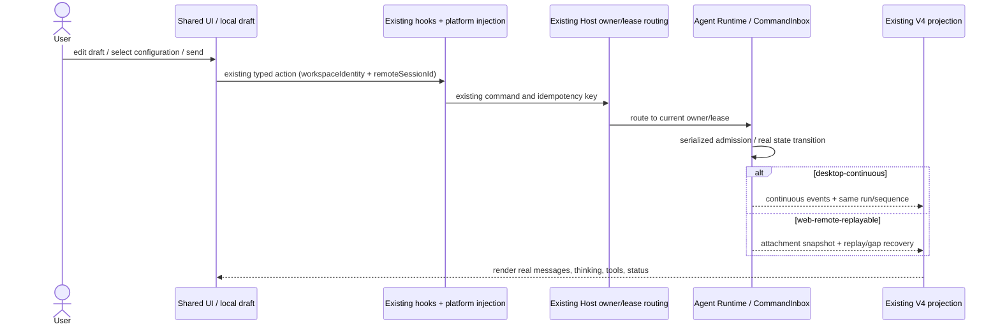

# XBuild Desktop UI Reconstruction — 设计与集成规格

日期：2026-11-14。状态：按用户授权自主连续实施；本规格先于行为/样式实现。

## 目标与证据边界

复现整套 Claude Desktop 的桌面信息架构、控件比例、界面层级与交互表现，底层继续运行 XBuild 的原生 Agent 系统。不嵌入 Claude，不复制闭源实现、专有字体、品牌图标或已登录用户数据，不用静态截图或 Mock Data 代替产品组件。

本机基线为 Claude Desktop **5.11492.5**。测量事实在 `docs/design/claude-desktop-reconstruction/reference-measurements.json`，公开交互资料在同目录研究报告。原生 CDS、Web 与 Fizzy Lake 样式声明在客户端中共存；静态声明不等于运行时激活证据。XBuild 使用原生 CDS 的中性层级与桌面密度，不能把旧版暖色 Chat 截图当作当前完整桌面设计。界面仍标识 XBuild，不冒用官方产品身份。

正常隔离 Claude 实例已启动；官方应用拒绝调试开关，系统未授权窗口截图。禁止通过修改客户端、关闭检查、使用原有账号或读取私人 profile 绕过。没有同状态官方截图时，不得给出像素一致率、虚构 Overlay/Difference 结果或宣称 1:1 已通过；实现和 XBuild 验证继续完成，缺失证据单独报告。

## 改造层级与架构

仅改变 `presentation`：共享主题、字体角色、布局、控件组成及交互 affordance。保留 React、Tailwind 4、Radix、Zustand、Lexical、Streamdown、现有图标、Electron 与 RPC，不新增运行时框架或不必要依赖。

沿用 `App` / `app-shell` / `project-sidebar` / `v4` / `prompt-editor` / `chat-input-toolbar` / 共享 primitives 与现有 Settings 入口。既有 components 均是真实可用的产品组件；公共样式和 tokens 是可复用 XBuild Design System，不创建另一套并行 app 或假数据页。

### 所有者与事件顺序



| 状态 | 唯一所有者 | 展示/写入边界 |
| --- | --- | --- |
| 未提交 prompt 与附件草稿 | 既有 Renderer draft owner | 不增加已接受队列，不改变上传事务 |
| accepted/busy/running 输入 | CLI/runtime CommandInbox | 仍通过现有命令串行 admission |
| message / Thinking / tool / session phase | 现有 Agent Runtime | V4 只读投影；不构造假 thinking 或状态 |
| 会话索引与项目列表 | 既有 Host/index/service | Sidebar 复用原 hook、过滤、排序和菜单 |
| 模型路由与配置 | 原有 provider registry / runtime model factory | UI 只提交原有配置命令 |
| theme / locale | 原有 store + preference/broadcast | 保留 applyingBroadcast 防回环，不创建第二个 theme store |
| Sidebar / pane 尺寸、开关 | 既有 UI layout preference | 更新默认比例；保留用户自定义与持久化 key |
| 文件、终端、MCP、插件 | 原有 platform/service/runtime | UI 通过 hooks 与 IPlatformService，禁止 Repo/Runtime 深导入 |

身份 key 仍为 `workspaceIdentity?.trim() || workspacePath`。路径用于文件操作、Git、cwd 与显示；owner/lease、跨 Host、stale run 和 remoteSessionId 边界不变。所有高频 stream 状态继续沿原有事件顺序处理，不使用超时掩盖同步问题。

## 设计系统合同

数值只在共享 CSS token 中维护。`DESIGN.md` 记录角色与使用规则，研究 JSON 仅记录官方静态参考值，不作为产品的第二套可变主题。

- Interface 使用合法系统 sans；阅读与欢迎标题允许明确的 serif voice role；代码、路径与终端保持既有 mono 和独立字号设置。不复制 bundled Anthropic 字体。
- 保留强制 `text-ui-*` role、UI font preference 与 mobile 16px editable floor；新增专用阅读/欢迎角色时先在 DESIGN 与 @theme 声明，禁止任意组件 inline 字号或改变根 html 字号。
- 原生侧栏参考宽度 288px，常规紧凑行 26px、图标 16px；Web/touch 使用宽松行与至少 44px 主要触控目标。新默认不能覆盖用户已保存的自定义尺寸。
- conversation 阅读 measure 768px；composer 与消息共用可收缩 reading rail，单列、分屏和 Side Pane 完整视图均不横向溢出。源码没有 wide/full 聊天宽度设置，不新增虚构偏好；既有完整面板、分屏和用户保存的面板尺寸继续保留。
- 桌面层级是窗口背景、Sidebar、conversation/terminal/Side Pane frame、card、menu/dialog；不把全部内容做成气泡卡。
- Composer 圆角采用专用 measured role（normal/comfortable），主输入、拖放覆盖层、附件与工具栏的边界统一；不破坏 Lexical、mention、slash、IME、Enter/Shift+Enter、上传 gate 或 busy input。
- 共享 Button、Input、Select、Dropdown、Popover、Dialog、Tooltip 统一中性层级、hover/focus/active/disabled 与 measured motion；Overlay 保持焦点陷阱、Esc、键盘导航和遮挡层级。
- 运动分为 fast/snap/base/layout；支持 prefers-reduced-motion。动画用于展示，不掌握 runtime truth；禁用炫光、弹簧、装饰性无限运动作为默认。
- 浅色与深色沿用当前持久化主题 ID，不删除旧偏好兼容。窗口 native material 设置继续由 IPlatformService 处理；CSS blur 只用于实际浮层，不伪造整个窗口背景。

## 完整页面与功能映射

| Claude 参考表面 | XBuild 产品实现 | 必须保留的行为 |
| --- | --- | --- |
| Window / navigation | DesktopWindowFrame + App shell | 原生窗控、窗口拖拽、Sidebar toggle、split、terminal、Side Pane |
| Sidebar / conversations | ProjectSidebar + task groups | New task/chat、搜索、排序、归档、置顶、分组、远端项目、已删除项目、拖拽 |
| New Chat / workspace | Existing draft/welcome + purpose navigation | 真实 workspace 选择、草稿、插件建议、原创建/预填入口 |
| Main chat / message menu | V4 timeline and message rows | 虚拟化、恢复、发送、停止、编辑、fork、重试、复制、分享、选择引用 |
| Model / effort selector | Existing toolbar menus | OpenAI/Anthropic 适配、provider family、实际 model config、thought/effort、禁用和 unavailable |
| Composer / attachment | Existing Lexical editor + upload pipeline | 文本、图片、文件、mention、slash、MCP、contexts、drop/paste/remove、loading/error |
| Thinking / Tool Calling | Existing real projection renderers | 思考折叠、真实用时、参数、结果、流式预览、权限、错误、background/subagent/workflow |
| Artifact / files / code | Existing preview cards + Side Pane | HTML/PDF/Office/image/code/diff/browser/terminal、下载、真实文件路由 |
| Settings / account | Existing Settings and user menu | 所有配置页、模型/provider/MCP/插件、DSH、远端、权限、快捷键、主题、字体、账号、反馈 |
| Search / popover / dialogs | Existing search and primitives | 焦点恢复、Esc、结果/空白/错误、menu positioning、屏幕边缘翻转 |
| Mobile remote | Existing remote mobile shell | 原 attachment/replayable、drawer、输入区与移动窗口主题；不创建新 Agent/Host |

不得删除、取消注册、以 disabled stub 替代上述任一现有能力。用户不能使用的第三方云产品能力不造假，映射到 XBuild 已有对应能力或明确标注为参考差异。

## 验收场景

每个新增/调整交互先维护 E2E，之后实现。App 业务单测已退役；新增浏览器/Electron acceptance 和工程 tooling 回归，不恢复源码旁 App test/spec 或 contract.test.ts。

| ID | Setup → action → assertion | 状态 |
| --- | --- | --- |
| CDR-01 | clean XBuild、1200×800、浅/深 → 打开主界面 → Sidebar 默认比例、frame、reading rail、composer 和无横向溢出 | accepted |
| CDR-02 | wide 与 768/390px → 收起/展开 Sidebar、Side Pane、resize → 原 controls 可用，draft 不丢，布局不挤掉 composer | accepted |
| CDR-03 | 新草稿 → 输入/模型/附件菜单/取消 → 原 draft/config 命令和 menu keyboard/Esc 行为；不自动发送 | accepted |
| CDR-04 | 独立测试 runtime、provider replay fixture → 发送、Thinking、tool call、stream completion → 渲染真实 runtime event，copy/collapse 能工作 | accepted |
| CDR-05 | 运行中/权限等待/error → 操作原 stop/permission/retry → 当前真实状态与原命令结果，不新增 accepted queue | accepted |
| CDR-06 | 打开 settings/account/search → 逐类入口与主题切换 → 配置表面可达、完整内容保留、popover 有稳定 shadow/focus | accepted |
| CDR-07 | markdown/code/文件产物 → 展开 code/preview/download → 使用原组件和平台路径、非 screenshot stub | accepted |
| CDR-08 | 主题/locale/custom UI font/reduced-motion → 切换与重载 → 原持久化有效、几何不随 html scale 改变、移动输入 floor | accepted |
| CDR-09 | 同尺寸、主题、状态的合法官方截图 → compare 工具 → Overlay、Pixel Difference、measure/scroll/motion 记录 | accepted，官方截图采集受系统权限/登录阻塞 |

保留状态覆盖清单逐项区分：implemented、asserted、executed、blocked、reference-only。测试 fixtures 仅用于隔离验收，永不接入 production component 数据来源。

## 验证与交付

必须实际执行 `pnpm typecheck`、`pnpm lint`、`pnpm architecture:check --changed`、变更格式检查、目标 E2E/浏览器验证、视觉 tooling 工程回归，以及真实 desktop/web build。Node 固定为 mise.toml 的 24.14.0；缺少 mise 时使用同版本 Node，不永久更改项目工具链。

交付研究报告、共享 Design System、真实组件与 native integration、覆盖清单、自动化 acceptance/tooling、诚实的视觉对比报告和本机可直接运行构建。其它平台的源码/响应式验证不冒充 Windows/Linux 实机验证。保留任务外 DSH 本地改动；不擅自 commit、push、PR 或发布。

## 2026-11-15 续作范围

本次继续完成现有方案，不重设架构、主题 owner 或会话语义。先前的共享组件验收不等于整套应用验收；每类表面的可达、动作、焦点与几何必须有独立断言和本次运行记录。

- 普通桌面项目/会话行使用共享 compact role，单行最小高度 26px；多行最近更新、工作流与远程状态允许内容撑高，不能剪掉状态或操作。主要触控行在窄屏至少 44px。保留置顶、未读、归档、重命名、拖拽、文件入口及原复合身份。
- Sidebar 分区辅助标题使用 `text-ui-sm`，项目/会话主要标题使用 `text-ui-caption`；搜索及筛选入口保持原独立按钮和键盘提示。已有 `command-center-focus` 几何断言先更新到此合同，保留焦点、divider resize 与 forced-colors 断言。
- 账户入口仍显示当前真实用户或登录状态，菜单保留设置、订阅/团队、反馈、更新、退出等原能力；名称可截断，菜单需屏幕边缘约束和 Esc 后焦点返回，不读私人账号作为参考数据。
- 搜索继续使用原 cmdk 查询、来源与结果，调整表面/行的 role，不替换数据来源或增加搜索索引。菜单打开、关闭和 Settings 返回不得清空未发送草稿。
- Composer model/provider/effort、附件与上下文继续使用既有菜单、选择和 upload transaction。触发器共享 16px 图标与 compact control；选择真实配置，取消不提交 prompt，错误和禁用态仍来自原 owner。
- 文件、代码、Markdown、Thinking、Tool Calling、permission、streaming、背景任务和 Side Pane 仅调整外层呈现。专门验收必须使用真实 CLI/Host/projection 与既有 replay 上游，不把本次纯 UI case 的通过记为这些运行态通过。
- 字母间距统一为 0。字号偏好只改变 interface/reading roles，不能通过 viewport 宽度或根 `html` 字号缩放控件；欢迎标题允许同一 role 的紧凑变体。
- 当前源码核对没有 conversation wide/full 宽度字段；旧 864/1280px container 自动布局由本次统一阅读 rail 取代，属于授权的呈现比例调整，不改变 Side Pane 完整视图与 resize 所有者。不能因旧说明误称设置而新增第二套偏好或配置写入路径。
- Markdown 正文使用已声明的 `text-ui-prose` / 1.4 行高与零额外字距；标题、表格、行内代码和控件继续按既有专用 roles，代码内容继续独立字号与换行偏好。不改变 Streamdown、citation、文件链接、流式/完成态解析或渲染缓存所有权。
- 文件产物卡使用 8px frame radius、原图标/真实标题/状态和分段打开按钮；文件预览 header 使用共享 36px structural role。实际 stat、文件 reader、native/remote 分流、下载/保存和 guest 生命周期不变。
- 附件媒体与文件卡继续 48px，上传百分比使用现有 `text-ui-xs`，不能使用任意 7px 字号；移除/重试/上下文关闭按钮在 hover、keyboard focus 和 touch 状态均可发现并保留原动作。关闭控件不改变 upload ready gate 或 accepted/adopt 事务。
- Side Pane 与 terminal 仅将呈现 opacity transition 接入共享运动 role；reduced-motion 关闭展示动画，不改变原状态 owner、收起完成边界、resize admission 或实例保活。
- Desktop 与宽屏 Web 的 Side Pane 分隔热区及可见面板间距统一为 4px，复用已有共享 resize handle；2px 指示线距左侧 1px，保持透明默认态、hover/focus/drag 显示。关闭、完整视图及手机路径仍移除或隐藏分隔条。此项是 XBuild 独立面板几何合同，不是已确认的官方运行态测量；取代历史 3px 规则，不改变保存尺寸、最小宽度或 pane owner。
- 默认主草稿欢迎字号不随窗口宽度缩放；只有显式的 remote-control compact presentation 使用紧凑 role。窄窗通过自然换行和可收缩阅读轨道适配，不增加测量字号状态。
- Thinking/状态使用的共享 Shimmer 在 reduced-motion 下静止并保持文字可见；只停展示动画，不改变真实 runtime phase、elapsed time 或流式事件。
- 共享浮层阴影须在内容根节点自身持有键盘焦点时保留；不能仅验证首个菜单项聚焦，也不能用全局 outline 覆盖完成。Sidebar 的 New Task 组合控件及其子内容均遵循 desktop compact / mobile touch 高度；保持当前唯一新建命令、disabled guard 与 telemetry，源码未提供的二级菜单不新增。字标的实际文本节点使用零字距。手机远控无设备导航时继续保留原 44px 顶部安全空间，共享 padding 不能覆盖该局部平台条件。
- 生产可运行包与 E2E bridge 构建分别记录。先完成类型检查，再构建当前源码 E2E 产物；最终 `.app` 从无 bridge 的 production 构建产生，不携带验收账号、replay server 或测试 state bridge。

```text
现有行为规格 -> 对应真实入口的验收断言 -> presentation roles
                                                  |
                         固定 Node 检查 -> 隔离 E2E 构建/运行
                                                  |
                         无 bridge production 构建 -> 独立运行验证
```

本节不把所有旧文件迁入新模块。对已存在且只调整呈现的 legacy 文件使用当前架构策略允许的精确路径准入；禁止新增 executable source 到未受管目录，也不为通过门禁扩大 Runtime、Host 或项目目录所有权。

## 2026-11-18 真实截图基准与 XBuild 品牌 / 动效

用户提供了四张当前真实运行态截图（空态、分栏会话、Terminal + Files、错误态），位于
`docs/design/claude-desktop-reconstruction/reference/`。这些是布局、信息层级与交互关系的直接基准；
此前“官方截图受权限阻塞”的限制不再适用于这四张，但不同窗口、不同状态仍不能拿来做有效的像素差分。
实测记录见 `reference-measured-delta.md`，没有实测依据的动画与浅色主题不冒称已验证。

### 品牌与几何

- 产品品牌统一为 **XBuild**，不使用 Claude 名称、文字标志或八芒星品牌图形。用户提供的
  `Xiatian AI Starburst Logotype.png` 是授权品牌参考；界面采用其四向尖星的几何语言，
  文字明确写 XBuild，不把 Xiatian AI 文案带进产品。已有 `ZCodeAboutLogo` /
  `ZCodeStartupLogoBadge` 仍是渲染入口，避免并行品牌组件。
- 草稿页 greeting + composer 使用独立 **672px** 上限（截图 1582px 宽窗口实测 671.5px）。
  会话正文继续使用 768px reading rail。此前把草稿也改为 768px 是未对照真实截图的错误推断，
  本次纠正；不是恢复 `ConversationComposer.centered` 的局部限宽，唯一宽度所有者仍是 Timeline 的
  `xb-draft-reading-rail`，dock、greeting 与建议列表共享中心轴。
- 深色 content frame 为实测 `#191919`，sidebar 为 `#1f1f1f`，描边 `#303030`。content 不再错误继承
  sidebar 的 `#1f1f1f`。品牌色只用于小型 XBuild mark，不替换状态色、不铺大面。
- 草稿问候的整组（mark + 文本）与 composer 同轴；不能错误要求包含星标的文字 `h1` 自身也达到
  672px。窄屏允许文本自然换行、mark 让位，不能横向溢出。
- 工作区/项目与 Git 分支入口继续由 `ProjectComposerMenu` 和原 Shell 回调拥有。草稿 composer 呈现为
  单一输入面 + 下方轻量项目行，而不是两个重叠大卡片；不改变项目选择、远程工作区或 Git 菜单动作。
  已存在的新建、搜索、自动化、插件、最近会话、错误、Terminal / Files 等入口保持真实功能，不伪造
  Claude 的 Projects / Artifacts 云端能力或复制其品牌文案。

### 动效语言

参考本地 Lusion 研究包的分段进场、形变、错峰与惯性节奏，但不复制其专有代码、字体、模型或持续
WebGL 场景，也不引入额外运行时依赖。主工作区继续使用 `motion/react` 与 transform/opacity 合成动画：

1. 新草稿初次挂载时，XBuild 星标轻微旋转/展开，问候与 composer 顺序进场；总时长小于 1 秒，
   使用短距离、可中断、非弹簧式 easing。时间问候更新不反复重播。
2. 推荐列表沿用真实 Client Scenes / plugin 解析 / automation 入口，改为参考图的安静垂直列表；
   每项只播放一次轻微位移与淡入。推荐点击仍走原 `handleSelect`，不自动发送、不替换 prompt owner。
3. `prefers-reduced-motion` 下直接展示最终状态，无逐字、旋转、错峰或无限装饰动画；运行状态、
   流式事件和倒计时不受展示动画控制。
4. 不为“高级感”加入大面积光晕、玻璃卡片、鼠标粒子或持续背景循环；保留密集、可读、键盘优先的
   桌面体验。光暗主题、中文长文案、480px 桌面下限及移动远控复用同一几何合同。

### 验收更新

- CDR-01 实测草稿 dock / greeting 组合 / composer 宽度均为 672px 且同轴，XBuild 四向 mark 可见、
  greeting 使用合法 serif voice、内容页与侧栏表面分离。窄窗与两个主题仍检查无横向溢出。
- CDR-03 继续验证真实菜单取消与 draft/config 保留；新增检查草稿推荐列表的动作仍连接到原有
  Client Scenes 解析路径，不以按钮文本或 fixture 冒充实际功能。
- CDR-08 检查草稿和 composer 在 reduced-motion 下静止于终态；使用已有真实 Side Pane / terminal
  动画探针，不把没有 DOM 动画误算为 runtime 状态静止。
- CDR-09 已有真实参考可支持视觉审查与几何测量；像素差分仍需同窗口尺寸、DPR、主题、状态的配对
  证据，视觉对齐不能宣称已经 1:1 或像素一致。
